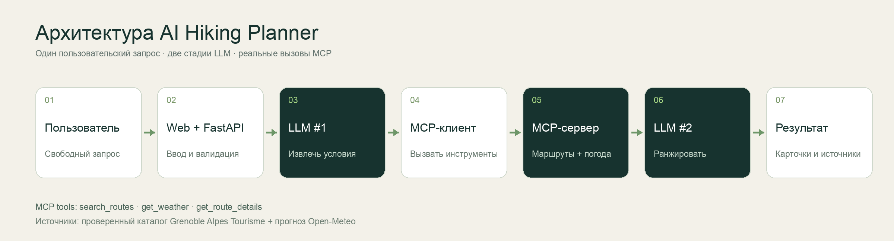

# Тропа — AI Hiking Planner

Сервис подбирает однодневные пешие маршруты вокруг Гренобля по запросу обычным языком. Пример: «Найди поход рядом с Греноблем на 4 часа, с озером, не слишком сложный». Локальная языковая модель разбирает условия, сервис получает проверенные маршруты и прогноз через MCP, затем модель ранжирует варианты. Сайт объясняет выбор на основе проверенных характеристик маршрутов.

**Работающий сайт:** [http://2.31.65.158](http://2.31.65.158)

**Интерактивная HTML-презентация:** [http://2.31.65.158/presentation](http://2.31.65.158/presentation)

> MVP ограничен окрестностями Гренобля. Длительность, набор высоты и сложность взяты из исходных карточек маршрутов. Прогноз относится к точке старта и не гарантирует безопасность всей тропы.

## Пользователь и сценарий

Пользователь планирует прогулку и знает, сколько времени готов идти, какой уровень сложности ему подходит и что хочет увидеть. Он вводит пожелания на сайте и получает до трёх вариантов с длительностью, длиной, набором высоты, прогнозом, объяснением и ссылкой на исходное описание. Если совпадений нет, сервис явно называет отличия ближайших вариантов.

## Границы MVP

- Семь маршрутов вокруг Гренобля с проверенными характеристиками и ссылками на [Grenoble Alpes Tourisme](https://www.grenoble-tourisme.com/fr/faire/toute-offre-outdoor/marcher-courir/).
- Запросы на русском; поддерживаются длительность, сложность и озеро.
- Прогноз [Open-Meteo](https://open-meteo.com/en/docs) для даты в пределах 16 дней. Погода отображается для координат старта маршрута.
- Визуал на сайте — декоративная AI-иллюстрация Альп, **не фото конкретного маршрута**. Ссылки на местоположение открывают OpenStreetMap.
- Не проверяются состояние троп, наличие льда и снега по всему маршруту, транспорт и бронирование.

Подробные условия и критерии приёмки: [SPEC.md](SPEC.md).

## Архитектура



1. **Web → FastAPI.** Валидация запроса и даты.
2. **LLM №1.** Ollama `qwen3:4b-instruct` извлекает параметры запроса в JSON по схеме Pydantic.
3. **MCP-клиент → MCP-сервер.** Отдельный Python-процесс обменивается сообщениями по `stdio`. Backend вызывает `search_routes` и `get_weather`; сервер читает каталог `data/routes.json` и получает прогноз Open-Meteo. Также доступен `get_route_details`.
4. **LLM №2.** Модель получает кандидатов и прогноз, выбирает и ранжирует до трёх маршрутов.
5. **Проверка и вывод.** Backend принимает только известные ID маршрутов. Название, цифры, ссылки и краткое объяснение формируются из каталога, а не из свободного текста модели. В интерфейсе можно открыть журнал этапов LLM → MCP → LLM.

В рамках одного запроса MCP реально используется для доступа к данным; это не декоративное упоминание протокола. Сервер определён в `app/mcp_server.py`, вызовы клиента — в `app/planner.py`.

## Стек

Python 3.11+, FastAPI, официальный Python MCP SDK, Ollama с Qwen3 4B Instruct, Open-Meteo, HTML/CSS/JS. На сервере используются Nginx и systemd. Внешний LLM API-ключ не нужен.

## Запуск локально

```bash
python3 -m venv .venv
.venv/bin/pip install -r requirements.txt
ollama pull qwen3:4b-instruct
ollama serve
```

В другом терминале:

```bash
.venv/bin/uvicorn app.main:app --host 127.0.0.1 --port 8000
```

Откройте `http://127.0.0.1:8000`. Для другого адреса Ollama задайте `OLLAMA_URL`; для другой установленной модели — `OLLAMA_MODEL`. Модель должна поддерживать структурированный JSON-ответ. `GET /api/health` проверяет доступность модели. Запрос может занимать несколько минут на CPU.

## Развёртывание на Ubuntu

Проект развёрнут на Ubuntu 26.04, 4 vCPU, 8 ГБ RAM. Ollama установлен как systemd-сервис и слушает только `127.0.0.1:11434`. Сайт запускается отдельным пользователем `hiking` на `127.0.0.1:8000`; Nginx публикует его на порту 80. Файлы конфигурации находятся в `deploy/`.

Для повторного развёртывания на чистой Ubuntu установите Ollama [по официальной инструкции](https://docs.ollama.com/linux), загрузите модель, установите `python3-venv` и `nginx`, скопируйте репозиторий в `/opt/ai-hiking`, затем выполните от root:

```bash
cd /opt/ai-hiking
ollama pull qwen3:4b-instruct
bash deploy/install.sh
systemctl status ai-hiking
curl http://127.0.0.1/api/health
```

Для публичной ссылки по IP используется HTTP. Домен и HTTPS — следующий шаг для постоянной эксплуатации; секретов или личных данных пользователей сервис не хранит.

## Eval и разбор ошибок

Проверка включает основной запрос, короткий лёгкий маршрут, отсутствие точного совпадения, сезонность, дату вне горизонта прогноза и фактические MCP-вызовы. Фиксируем время ответа, выбранные ID, соответствие ограничению длительности и сложности, наличие ссылок и обработку недоступного прогноза. Набор сценариев и проверочный скрипт находятся в `eval/`.

**Результат прогона 26 октября 2026: 4/4 сквозных сценария прошли.** Измеренные времена: 3,1–12,9 с на прогретой модели. Подробная таблица и три исправленные ошибки — в [eval/RESULTS.md](eval/RESULTS.md); машинный вывод — в [eval/results.json](eval/results.json).

## Источники

- [Grenoble Alpes Tourisme — каталог пеших маршрутов](https://www.grenoble-tourisme.com/fr/faire/toute-offre-outdoor/marcher-courir/). Каждая запись `data/routes.json` содержит ссылку на конкретную карточку.
- [Open-Meteo — документация прогноза](https://open-meteo.com/en/docs) и [условия использования](https://open-meteo.com/).
- [MCP Python SDK](https://github.com/modelcontextprotocol/python-sdk).
- [Ollama — tool calling](https://docs.ollama.com/capabilities/tool-calling) и [Qwen3 в Ollama](https://ollama.com/library/qwen3).
- [OpenStreetMap — атрибуция](https://www.openstreetmap.org/copyright). Ссылки на карту ведут к точкам старта; геометрия самих маршрутов в MVP не воспроизводится.
